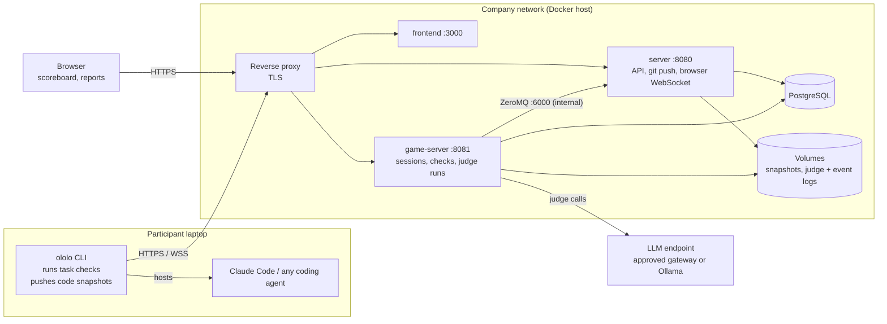

# Self-hosting ololo inside a company network

This guide is for teams that want to run ololo on their own infrastructure,
so that coding sessions can use the company's own repositories without any
code leaving its network. It is written to be handed to a security team: it
covers what the platform is, how it is deployed, which data it handles,
where that data goes, and what the reviewer should validate.

- What ololo is: [What is ololo](https://ololo.dev/documentation/what-is-ololo)
  (with a one-minute demo), [How a session works](https://ololo.dev/documentation/how-a-session-works),
  [Points and judges](https://ololo.dev/documentation/points-and-judges).
- Source code: this repository, licensed [Apache-2.0](../LICENSE).

## Contents

- [What gets deployed](#what-gets-deployed)
- [Architecture](#architecture)
- [Data flows](#data-flows)
- [Security model](#security-model)
- [Installation](#installation)
- [Configuration reference](#configuration-reference)
- [LLM judges](#llm-judges)
- [Operations](#operations)
- [Security review checklist](#security-review-checklist)

## What gets deployed

The open platform in this repository: the main server, the game server, the
web frontend, the participant CLI, example projects and judges. The hosted
service at [ololo.dev](https://ololo.dev) runs the same core plus closed
parts (billing, a global ladder, a larger project library); none of those
are needed for a self-hosted deployment, and none of them are in this tree.

In scope for a review: three containers and a database on one Docker host,
the participant CLI on each laptop, and the LLM endpoint the judges call.

## Architecture

Three containers and a database run on one Docker host inside the company
network; participants connect to them over HTTPS from their laptops.



The CLI on each laptop hosts the coding agent, runs the task checks locally
and pushes code snapshots to the server. The server and the game server share
the database and the snapshot volume and pass live events over an internal
ZeroMQ bus. The game server calls the LLM endpoint for judge runs. All
components are Rust services except the SvelteKit frontend; the source
layout is in the [README](../README.md#architecture).

## Data flows

With the configuration in this guide, the only data that leaves the company
network is a daily CLI version check against GitHub, plus whatever the
company's chosen LLM endpoint is allowed to receive. Every other flow below
either stays inside or is off by default.

### Stored on the server

| Data | Where | Contents |
| --- | --- | --- |
| Accounts | Database | Username, email, Argon2 password hash, SHA-256 hashes of personal access tokens |
| Sessions and scores | Database | Tasks, check results (pass/fail, duration, exit code, last 64 KB of output), scores, judge verdicts, reports |
| Code snapshots | `git-repos` volume | One bare git repository per participant per session |
| Judge run logs | `judge-logs` volume | Full prompts, model replies and tool outputs of each judge run |
| Session event logs | `session-logs` volume | Per-participant event stream (JSONL), admin download only |
| Agent usage stats | Database | Token counts, tool-call and skill-load counts per task; no prompts or transcripts |

### Sent by the participant CLI

- **Code snapshots.** The CLI commits the working directory to a private
  repository outside the worktree and pushes it to the server over
  git-over-HTTPS. It honours `.gitignore` and an optional `.ololoignore`,
  and never uploads `.env` files, private keys, credential files, `.git`,
  dependency folders or build output
  ([`ololo/src/snapshot/files.rs`](../ololo/src/snapshot/files.rs)).
- **Check results** over WebSocket: pass/fail, duration, exit code and the
  tail of the output.
- **Agent token usage.** The CLI reads the local agent session logs and sends
  only counts (tokens, tools, skills), never the conversation
  ([`agent-tokens/README.md`](../agent-tokens/README.md)).
- **Artifacts on request.** A judge may ask for a screenshot or a recording
  of the running product; it is uploaded only when the participant delivers it.

### Outbound connections

| From | To | When | Recommended setting |
| --- | --- | --- | --- |
| Game server, server | LLM endpoint | Judge runs; project drafting and between-task notes on the server | An approved internal endpoint (see [LLM judges](#llm-judges)) |
| Participant CLI | `api.github.com` | At most once per 24 hours, version check only | Allow, or block at the proxy (fails silently) |
| Server | AWS SES or Cloudflare Email | Password reset, magic links, notifications | Off unless configured |
| Browser, server | ImageKit | Avatar uploads | Off unless keys are set |
| Browser, server | Cloudflare Turnstile | CAPTCHA on login | Off by default (`TURNSTILE_ENABLED=false`) |

The open platform has no analytics beacon, no telemetry to ololo.dev and no
social login.

## Security model

ololo uses an honest-trust model: participants and task authors are trusted,
and nothing on the participant's laptop is sandboxed by the platform. Inside
a company this fits well, because task authors are the deployment's admins
and participants are the company's engineers. The full statement is in the
README's [Trust model](../README.md#trust-model); the participant-facing
version is [Playing safely](https://ololo.dev/documentation/playing-safely).

### Participant laptop

- Task checks are tests written by the project author. The CLI runs them
  under the participant's own account.
- Placeholder values in those commands are shell-escaped (`shlex::quote` on
  Unix, a strict character set on Windows) and executed without a shell.
  This is defense in depth, not a guarantee.
- The coding agent runs as usual, with the participant's file system and
  credentials. Recommendation: run sessions in a dev container, a VM or a
  separate OS user, not on a machine holding production credentials.
- Results reported by the CLI (pass/fail, timings) are trusted without
  cryptographic verification. A participant can fake a score; this affects
  the leaderboard, not company systems.

### Authentication and access

- Accounts use email and password, hashed with Argon2. Browser sessions use
  an HS256 JWT access token (15 minutes) and a refresh token (30 days), both
  in `HttpOnly; Secure; SameSite=Lax` cookies.
- The CLI uses personal access tokens (`ololo_` + 32 random bytes); only their
  SHA-256 hash is stored.
- State-changing requests are checked against an allow-list of frontend
  origins (`ARENA_FRONTEND_ORIGINS`). Login and registration are rate-limited
  per IP.
- The first account registered becomes the admin. Registration is otherwise
  open to anyone who can reach the URL, so the deployment must sit behind the
  company network or VPN.
- Calls from the server to the game server carry a token derived from
  `JWT_SIGNING_KEY`. The ZeroMQ event bus between them (port 6000) is
  unauthenticated and must stay on the internal Docker network.

### Server-side code execution

Only one feature runs participant code on the server: the execution judge
(`golf-verify`), which re-runs committed code under a bubblewrap sandbox
(`arena_core::sandbox`). To make bubblewrap work inside a container, the
game-server needs `SYS_ADMIN` plus unconfined seccomp, AppArmor and system
paths, which weakens that container's own isolation.

**Recommendation:** remove `security_opt` and `cap_add` from the game-server
service and do not run golf projects. The execution judge then refuses to
score instead of running code; nothing else is affected.

### Known limitations

- No single sign-on in the open platform; accounts are local to the deployment.
- No switch to close registration; access control is by network placement.
- Judge run logs keep full prompts and model replies, including code
  excerpts, on the `judge-logs` volume.
- No per-team permissions beyond session membership and project ownership.

## Installation

Run the prebuilt open-source images with
[`docker-compose.yml`](../docker-compose.yml), pinned to the reviewed commit.
Every push to this repository's `main` builds `ghcr.io/ololo-dev/ololo-server`,
`ololo-game-server` and `ololo-frontend` from this tree in GitHub Actions
([`release.yml`](../.github/workflows/release.yml)) and tags them `latest`
and `sha-<short commit>`. They contain only the open code in this
repository; nothing in them points at ololo.dev.

To build the images yourself instead, use
[`docker-compose.source.yml`](../docker-compose.source.yml) with
`docker compose -f docker-compose.source.yml up -d --build`; the steps are
otherwise the same.

> **Set `OLLAMA_URL` explicitly.** `docker-compose.yml` defaults it to
> `https://ollama.ololo.dev`, the shared model host of the public demo; an
> empty value falls back to that default too.

### Prerequisites

- A Linux host with Docker Engine and Docker Compose v2.
- Two internal DNS names with TLS certificates, for example
  `ololo.example.internal` (web app and API) and
  `ololo-gs.example.internal` (game server WebSocket).
- A reverse proxy for TLS termination (Traefik, nginx or an existing ingress).
- PostgreSQL (SQLite on a volume is fine for a pilot).
- An approved LLM endpoint for the judges.

### Steps

1. Clone the repository at the reviewed commit:

   ```bash
   git clone https://github.com/ololo-dev/ololo.git && cd ololo
   git checkout <reviewed-commit>
   ```

2. Create the external Docker network the compose file expects:

   ```bash
   docker network create dokploy-network
   ```

3. Create `.env` next to the compose file, with secrets injected from your
   secret store:

   ```bash
   APP_DOMAIN=ololo.example.internal
   GS_DOMAIN=ololo-gs.example.internal
   JWT_SIGNING_KEY=<output of: openssl rand -hex 32>
   GAME_SERVER_ID=<output of: uuidgen | tr A-Z a-z>
   DATABASE_URL=postgresql://ololo:<password>@<db-host>:5432/ololo
   IMAGE_TAG=sha-<first 7 characters of the reviewed commit>
   # Internal Ollama, or http://localhost:11434 when judges use another provider
   OLLAMA_URL=http://ollama.example.internal:11434
   ```

4. In `docker-compose.yml`, remove `security_opt` and `cap_add` from the
   `game-server` service (see [Server-side code execution](#server-side-code-execution)).

5. Pull and start:

   ```bash
   docker compose up -d
   ```

6. Route traffic through the reverse proxy:

   | Host | Path | Service |
   | --- | --- | --- |
   | `APP_DOMAIN` | `/` | `frontend:3000` |
   | `APP_DOMAIN` | `/api`, `/auth`, `/git`, `/health`, `/ws` | `server:8080` |
   | `GS_DOMAIN` | all paths | `game-server:8081` |

   Port 6000 (event bus) and the database must not be routed.

7. Check health: `curl https://ololo.example.internal/health` returns `200`.

8. Register the first account right away; it becomes the admin. Then add the
   approved LLM provider in **Settings → AI** and run its connection test.

### Participant CLI

- Prebuilt binaries for Linux, macOS and Windows are on
  [GitHub Releases](https://github.com/ololo-dev/ololo/releases/latest).
  Mirror the reviewed version internally, or build it from the same commit
  with `cargo build -p ololo --release`.
- Each participant points the CLI at the deployment once:
  `ololo login https://ololo.example.internal`. It opens the browser to
  confirm and stores a personal access token in
  `~/.config/ololo/credentials.toml`.
- CLI usage and agent setup: [Installation](https://ololo.dev/documentation/installation).

## Configuration reference

Two secrets matter: `JWT_SIGNING_KEY` and the database password. Keep both in
a secret store and inject them as environment variables; nothing secret
belongs in the compose file. The full commented list is in
[`.env.example`](../.env.example).

| Variable | Required | Purpose | Recommended value |
| --- | --- | --- | --- |
| `JWT_SIGNING_KEY` | Yes | Signs tokens; also derives the key that encrypts stored API keys. Same value on both servers | 32+ random bytes |
| `APP_DOMAIN`, `GS_DOMAIN` | Yes | Public names of the web app and the game server | Internal DNS names |
| `GAME_SERVER_ID` | Yes | Stable UUID of the game server | Generate once |
| `DATABASE_URL` | No | Shared database; defaults to SQLite on a volume | PostgreSQL URL |
| `ARENA_FRONTEND_ORIGINS` | No | CSRF origin allow-list; defaults to `https://$APP_DOMAIN` | Default |
| `ARENA_ACCESS_TOKEN_TTL_SECONDS` | No | Access token lifetime, default 900 | Per policy |
| `ARENA_REFRESH_TOKEN_TTL_DAYS` | No | Refresh token lifetime, default 30 | Per policy |
| `OLLAMA_URL` | No | Internal Ollama for judges | Only if Ollama is used |
| `EMAIL_PROVIDER` and related | No | Password reset and magic links via SES or Cloudflare | Empty, unless email is needed |
| `IMAGEKIT_*` | No | Avatar uploads to ImageKit | Empty |
| `TURNSTILE_ENABLED` | No | Cloudflare CAPTCHA | `false` |
| `GAME_SERVER_ZMQ_BIND_ADDR` | No | Internal event bus address | Keep the internal Docker alias |
| `ARENA_LOG_FORMAT` | No | `json` for structured logs | `json` |

Rotating `JWT_SIGNING_KEY` signs every browser session out and makes stored
LLM API keys unreadable; re-enter them after a rotation.

## LLM judges

Judges are the only component that sends code to a language model, and the
endpoint is chosen by the deployment's admin. Nothing is sent to a model
until a provider is configured in **Settings → AI**.

| Provider | When to use |
| --- | --- |
| Custom (any OpenAI-compatible chat-completions endpoint with tool calling) | Preferred: an internal LLM gateway in front of the models the company already approves |
| Ollama | Fully on-premises models; set `OLLAMA_URL` to the internal host |
| OpenRouter, OpenCode Zen | Public routers; not recommended for private code |

API keys are stored in the database encrypted with AES-256-GCM; the key is
derived from `JWT_SIGNING_KEY` with HKDF-SHA256
([`arena-core/src/settings_encryption.rs`](../arena-core/src/settings_encryption.rs)).

What a judge sends to the model:

- the judge's own instructions — a markdown file in [`judges/`](../judges)
  that you can review and edit;
- the task brief written by the project author;
- files, diffs and commit history the judge reads, through tools, from the
  participant's snapshot repository on the server.

The server uses the same provider for two smaller features — drafting a
project from a description and extracting short notes between tasks — and
sends that session data nowhere else.

## Operations

The deployment is a database plus four volumes; everything else can be
rebuilt from the pinned commit.

| Item | What to do |
| --- | --- |
| Upgrades | Review the diff between the pinned commit and the new one, update the checkout and `IMAGE_TAG`, re-run `docker compose up -d`. Both servers apply database migrations on start |
| Backups | The database and the `git-repos`, `judge-logs` and `session-logs` volumes (plus `arena-data` when SQLite is used) |
| Logs | Structured JSON on each container's stdout |
| Health | `GET /health` on the server (8080) and the game server (8081); both containers have health checks |
| Retention | Snapshots, judge logs and event logs are kept until deleted; agree a period and clean the volumes on that schedule |
| Removal | `docker compose down -v` removes the containers and all volumes; drop the database separately. On laptops, delete the CLI binary and `~/.config/ololo/` |

## Security review checklist

To validate:

- [ ] Source review of the pinned commit, including `Cargo.lock` and `frontend/pnpm-lock.yaml`
- [ ] Images for that commit's `sha-` tag (or built in-house from it) scanned
- [ ] `OLLAMA_URL` set explicitly, not left at the public default
- [ ] Game-server runs without `SYS_ADMIN` and with default seccomp and AppArmor
- [ ] Only the web app and the game server are reachable through the proxy; port 6000 and the database are not
- [ ] The deployment is reachable only from the company network or VPN
- [ ] The LLM provider points at an approved endpoint, and no other provider is configured
- [ ] The CLI binary is verified against the reviewed commit or built internally
- [ ] Snapshot exclusion rules (`.gitignore`, `.ololoignore`, the built-in secret filter) are acceptable for your repositories

To decide:

- [ ] Which LLM endpoint the judges use
- [ ] Whether participants run sessions in a dev container or VM, or on their normal workstation
- [ ] Whether the daily CLI version check to `api.github.com` is allowed or blocked
- [ ] Retention period for code snapshots and judge logs
- [ ] Whether email (password reset, magic links) is needed, and through which relay
- [ ] Who owns the deployment: patching, backups, the admin account

Questions about self-hosting: open an issue in this repository or ask on
[Discord](https://discord.gg/TnD8WHWqKD).
